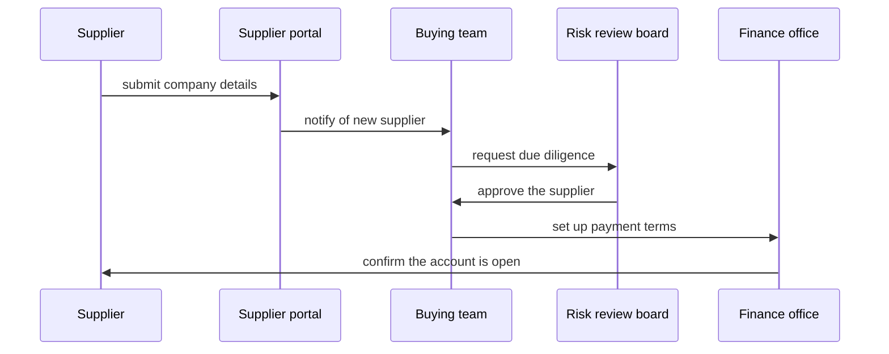

# Supplier onboarding

How the buying team, the risk review board and the finance office work together to bring on a new supplier, with the supplier taking part through the portal. Each party owns one decision and hands the case on.

## Who takes part

| Participant | What they do | Kind |
|---|---|---|
| Supplier | Provides company, bank and insurance details | external |
| Supplier portal | Collects the details and tracks the case | system |
| Buying team | Sponsors the supplier and owns the case | team |
| Risk review board | Decides whether the supplier passes due diligence | board |
| Finance office | Sets up payment terms and the supplier account | team |

## Sequence

## Agreements

The risk review board answers within ten working days. The buying team tells the supplier of a rejection.
